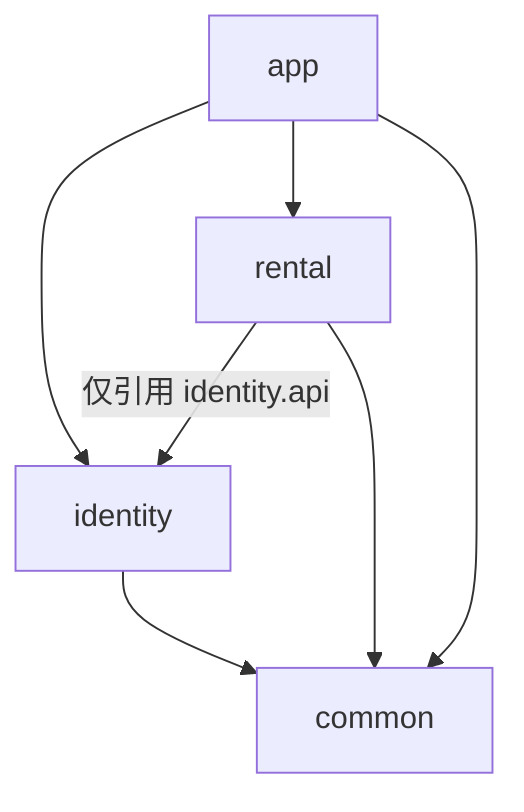

# RentalInfoSharing 租房信息共享平台

> 架构与部署文档 v0.5 · Maven 多模块、用户认证与用户端房屋信息管理已实现
> 后端栈：Java 21 + Spring Boot 3.5.16 + MyBatis-Plus 3.5.17 + PostgreSQL 16 · Spring Security + JJWT 0.12.6 · 前端选型待定（API First）

---

## 1. 项目背景与目标

一个由用户共建的租房信息共享平台：用户填写自己**实际租住过**的房子（城市、地址、租赁平台、租期、体验与踩坑等），供其他人参考，减少信息差。

**当前阶段已实现**：Spring Boot 模块化单体工程，后端分为 `common`、`identity`、`rental`、`app` 四个 Maven 子模块，由一个后端容器部署。接入现有 PostgreSQL、MyBatis-Plus、Flyway 13.10.0，提供统一响应、请求 traceId、全局异常处理、数据库健康检查，以及用户名密码注册、登录、JWT 鉴权、刷新轮换、登出和当前用户查询。租房模块支持新增、完整修改、本人软删除、公共及本人列表的分页筛选；公共列表不返回详细地址和用户信息。标准启动入口为 `docker compose up -d --build --wait`。

**后续 MVP 目标**：在现有登录、租房信息填写与列表查询基础上，单独设计信息绑定、资料修改、详情读取、浏览行为和评论；评论等能力后续新增独立模块。

**设计原则**

- API First：后端对外提供 REST，OpenAPI 文档后续接入，前端可随时替换（React / Vue / 小程序均可对接）。
- 最小依赖：统一使用 Docker Compose 部署；当前外部服务只有 PostgreSQL，不引入 Redis / MQ / 对象存储。
- 容器化部署（全项目强制准则）：所有当前及未来模块都通过容器部署，统一使用 Docker Compose 编排，构建工具与运行时也纳入镜像；宿主机只需 Docker 与 Docker Compose。
- 生产可迁移：数据结构、鉴权、分层方式按可上线标准设计，验证成功后可平滑演进。

**全局开发准则：所有模块容器化部署，便于迁移。** 该要求贯穿整个项目的技术选型、开发和交付，适用于后端、前端、管理端、定时任务及数据库、缓存等依赖服务。按可独立运行的应用或服务划分容器，同一应用内的功能模块随所属应用一起部署。

具体执行要求记录在项目根目录的 [AGENTS.md](AGENTS.md)：构建与运行环境容器化、Compose 统一编排、配置外置、数据持久化与备份恢复、版本与 CPU 架构兼容，以及新增模块时同步维护部署配置并验证。部署和迁移操作见第 9 节。

---

## 2. 验证版功能范围（MVP）

| 模块 | 功能 | 说明 |
| --- | --- | --- |
| 认证登录 | 注册、登录、刷新令牌、登出 | 用户名 + 密码注册、登录已实现；手机号/邮箱登录随信息绑定阶段接入 |
| 信息绑定 | 绑定/解绑手机号、邮箱 | 验证码验证；手机号/邮箱可作登录凭证与联系方式 |
| 租房信息（已实现） | 新增、完整修改、本人软删除、公共列表筛选 | 城市、地址、租赁平台、房东类型、租期、租金、体验评价；单条详情后续设计 |
| 个人中心 | 当前用户查询、本人房屋记录列表已实现；资料修改后续设计 | 本人记录列表返回完整地址及状态，供编辑使用 |
| 通用能力 | 统一响应、统一异常、参数校验；OpenAPI 文档后续接入 | 基础能力已实现 |

**明确不做（后续演进）**：图片上传、评论点赞、地图、举报审核、微信/短信真实通道、消息通知。

---

## 3. 总体架构

```text
前端（后续） → REST API → Controller → Service → Mapper → PostgreSQL 16
                         统一响应 / 全局异常 / 参数校验 / traceId
```

健康检查、认证、当前用户查询和房屋信息管理均采用 Controller → Service → Mapper 分层。所有业务模块共用 PostgreSQL、连接池和事务管理，不单独启动服务。

**分层职责**

| 层 | 职责 | 约束 |
| --- | --- | --- |
| Controller | 参数接收与校验、鉴权注解、组装响应 | 不写业务逻辑，不直接访问 Mapper |
| Service | 业务逻辑、事务边界、权限判断 | 返回 DTO，不暴露 Entity |
| Mapper | 数据访问（MyBatis-Plus / MyBatis） | 基础映射使用 BaseMapper，房屋筛选及原子归属校验使用参数化 XML SQL |
| Entity/DTO | 持久化模型 / 传输模型 | 严格分离，避免直接序列化 Entity |

---

## 4. 技术选型

| 类别 | 选型 | 理由 |
| --- | --- | --- |
| 语言 | Java 21（LTS） | 虚拟线程、记录类，Spring Boot 3.x 官方基线 |
| 框架 | Spring Boot 3.5.16 | 生态成熟，面试/维护友好 |
| Web | Spring MVC + Jackson | REST 标准方案 |
| 安全 | Spring Security + JWT（JJWT 0.12.6） | 无状态 Access Token + PostgreSQL 刷新令牌轮换 |
| ORM | MyBatis-Plus 3.5.17 | 提供基础 CRUD 与 MyBatis SQL 映射 |
| 数据库 | PostgreSQL 16（Docker） | 生产级，JSONB/数组等能力为后续扩展留空间 |
| 迁移 | Flyway 13.10.0 | 版本化 DDL，团队协作可追溯 |
| 校验 | Jakarta Validation | 声明式参数校验 |
| 文档（后续） | springdoc-openapi 2.x | 自动生成 Swagger UI，前端联调依据 |
| 构建 | Maven（spring-boot-starter-parent） | 简单稳定 |
| 验证 | JUnit 5 + 真实 HTTP + 独立 PostgreSQL 测试库 | 认证与房屋信息集成测试、ArchUnit 和 Compose 健康检查 |
| 前端 | **待定** | 后端先行，接口按 REST 契约迭代 |

---

## 5. 后端模块与目录结构

`common`、`identity`、`rental`、`app` 四个模块直接位于项目根目录，部署文档集中在 `docs/`。根目录 `pom.xml` 同时是 Maven 父工程、聚合工程和 IDE 导入入口，统一管理 Java、依赖和插件版本，各子模块显式声明所需依赖。

```
RentalInfoSharing/
├── pom.xml                         # 父工程与聚合入口，packaging=pom
├── Dockerfile                      # 构建四个模块，仅运行 app JAR
├── .dockerignore
├── docker-compose.yml              # PostgreSQL + 一个 backend 容器
├── .env.example
├── docs/DOCKER_STARTUP.md
├── common/                         # 普通 JAR：响应、异常、错误码、traceId
├── identity/                       # 普通 JAR：auth、user、identity.api 及实现
├── rental/                         # 普通 JAR：housing Controller、Service、DTO 和 Mapper XML
└── app/                            # 唯一可执行 Spring Boot JAR
    ├── src/main/java/com/rental/sharing/
    │   ├── RentalInfoSharingApplication.java
    │   ├── config/                 # 安全链、CORS、MyBatis 扫描等应用组装
    │   └── health/                 # 数据库健康检查
    ├── src/main/resources/
    │   ├── application.yml
    │   └── db/migration/V1__init.sql
    └── src/test/java/com/rental/sharing/
        ├── auth/AuthFlowTest.java
        ├── rental/RentalFlowTest.java
        └── architecture/ModuleArchitectureTest.java
```

依赖方向如下，箭头表示使用方依赖提供方：



- `common` 不依赖业务模块，`identity` 不依赖 `rental`，业务模块不依赖 `app`。ArchUnit 在组装应用的完整类路径上检查依赖方向。
- `identity` 包含现有 `auth`、`user`，继续在模块内部按功能域分包；对外只公开 `com.rental.sharing.identity.api`。`AuthenticatedUser(userId)` 是 JWT 验证后的请求身份；`IdentityAccess.requireActive(userId)` 检查账号存在且可用，不返回用户 Entity。JWT 验证和账号可用性检查是两个步骤，房屋服务的每次业务操作均调用该契约。
- `rental` 只能通过身份公开 API 协作，不能引用用户 Entity、Mapper 或认证内部实现。用户表（含绑定、验证码和刷新令牌）归 `identity`，`rental_records` 归 `rental`；模块通过自身 Mapper 访问所属数据。
- `app` 负责启动、配置、健康检查、安全组件组装和全部 Flyway 迁移。JWT Filter 只在 Security 链注册一次，traceId Filter 位于其之前。只有 `app` 执行 Spring Boot repackage，其余子模块生成普通 JAR，不单独部署。

业务边界：

| 模块 / 包 | 职责 |
| --- | --- |
| `rental` / `com.rental.sharing.rental.housing` | 已实现房屋／租住信息新增、存储、完整修改、分页筛选及本人软删除；详情读取后续设计 |
| 浏览行为模块（后续单独设计） | 阅读行为、浏览记录及相关统计，与房屋列表查询分开 |
| 评论模块（后续单独添加） | 围绕租房信息的评论 |

本次专注用户端信息增改查删，不添加管理端、评论、浏览行为、草稿或上下架接口。账号与基础资料始终归 `identity`。复用现有 `rental_records` 及索引，不修改已执行的 V1；后续数据模型变化通过新增 Flyway 版本演进。

---

## 6. 数据库设计

### 6.1 ER 关系

```
users 1 ──── n user_bindings         （每个账号最多一个手机号和一个邮箱）
users 1 ──── n refresh_tokens        （登录会话）
users 1 ──── n rental_records        （用户发布的租房记录）
verification_codes 按 scene + target 查询（验证码不直接关联 users）
```

### 6.2 表结构

**users 用户表**

| 字段 | 类型 | 约束 | 说明 |
| --- | --- | --- | --- |
| id | BIGSERIAL | PK | |
| username | VARCHAR(32) | UNIQUE NOT NULL | 登录名 |
| password_hash | VARCHAR(100) | NOT NULL | BCrypt |
| nickname | VARCHAR(32) | | 昵称 |
| avatar_url | VARCHAR(255) | | 预留 |
| status | SMALLINT | NOT NULL DEFAULT 1, CHECK 0/1 | 1 正常 / 0 禁用 |
| created_at / updated_at | TIMESTAMPTZ | NOT NULL DEFAULT now() | updated_at 由触发器维护 |

**user_bindings 绑定表**（登录凭证 & 联系方式）

| 字段 | 类型 | 约束 | 说明 |
| --- | --- | --- | --- |
| id | BIGSERIAL | PK | |
| user_id | BIGINT | FK → users NOT NULL | |
| bind_type | VARCHAR(16) | NOT NULL, CHECK PHONE/EMAIL | PHONE / EMAIL |
| bind_value | VARCHAR(128) | NOT NULL | 手机号 / 邮箱 |
| verified | BOOLEAN | NOT NULL DEFAULT false | 是否已验证 |
| created_at | TIMESTAMPTZ | NOT NULL DEFAULT now() | |
| — | — | UNIQUE(bind_type, bind_value) | 一个手机号/邮箱只能绑一个账号 |
| — | — | UNIQUE(user_id, bind_type) | 每个账号最多绑定一个手机号和一个邮箱 |

**verification_codes 验证码表**

| 字段 | 类型 | 说明 |
| --- | --- | --- |
| id | BIGSERIAL PK | |
| scene | VARCHAR(24) | NOT NULL，CHECK BIND_PHONE / BIND_EMAIL / RESET_PWD |
| target | VARCHAR(128) | NOT NULL，手机号 / 邮箱 |
| code_hash | VARCHAR(64) | NOT NULL，验证码哈希（不存明文） |
| expires_at | TIMESTAMPTZ | NOT NULL，由业务设置 5 分钟有效期 |
| used_at | TIMESTAMPTZ | 使用后置位 |
| attempt_count | SMALLINT | NOT NULL DEFAULT 0，CHECK 0~5，最多试错 5 次 |
| created_at | TIMESTAMPTZ | NOT NULL DEFAULT now() |

> 本地验证版：验证码「发送」走 Mock 通道，dev profile 下写入日志，方便本机调试。

**refresh_tokens 刷新令牌表**

| 字段 | 类型 | 说明 |
| --- | --- | --- |
| id | BIGSERIAL PK | |
| user_id | BIGINT FK NOT NULL | 所属用户 |
| token_hash | VARCHAR(64) | UNIQUE NOT NULL，存储 SHA-256 哈希 |
| expires_at | TIMESTAMPTZ | NOT NULL，由业务设置 7 天有效期 |
| revoked | BOOLEAN | NOT NULL DEFAULT false，登出/轮换后置 true |
| created_at | TIMESTAMPTZ | NOT NULL DEFAULT now() |

**rental_records 租房记录表**（核心业务表）

| 字段 | 类型 | 约束 | 说明 |
| --- | --- | --- | --- |
| id | BIGSERIAL | PK | |
| user_id | BIGINT | FK NOT NULL | 发布者 |
| city | VARCHAR(32) | NOT NULL | 城市，如「杭州」 |
| district | VARCHAR(32) | | 区县，如「西湖区」 |
| address | VARCHAR(255) | NOT NULL | 详细地址，仅本人记录列表返回，公共列表完全省略该字段 |
| community_name | VARCHAR(64) | | 小区名 |
| rental_platform | VARCHAR(64) | | 租赁平台：贝壳/自如/链家/个人房东… |
| landlord_type | VARCHAR(16) | | 房东直租 / 二房东 / 中介 / 品牌公寓 |
| room_type | VARCHAR(16) | | 整租 / 合租 / 主卧 / 次卧 |
| monthly_rent | NUMERIC(10,2) | CHECK >= 0 | 月租金（元） |
| deposit_desc | VARCHAR(32) | | 押付方式，如「押一付三」 |
| rent_start_date | DATE | | 入住日期 |
| rent_end_date | DATE | CHECK >= rent_start_date | 搬离日期 |
| rating | SMALLINT | CHECK 1~5 | 综合体验评分 |
| highlights | TEXT | | 优点 |
| pitfalls | TEXT | | 踩坑/注意事项 |
| content | TEXT | | 详细经验描述 |
| status | SMALLINT | NOT NULL DEFAULT 1, CHECK 0/1 | 1 已发布 / 0 已下架 |
| created_at / updated_at | TIMESTAMPTZ | NOT NULL DEFAULT now() | updated_at 由触发器维护 |
| deleted_at | TIMESTAMPTZ | | 软删除 |

**索引**

```sql
CREATE INDEX idx_rental_city_created  ON rental_records (city, created_at DESC);
CREATE INDEX idx_rental_platform      ON rental_records (rental_platform);
CREATE INDEX idx_rental_user          ON rental_records (user_id);
CREATE INDEX idx_refresh_tokens_user  ON refresh_tokens (user_id);
CREATE INDEX idx_verification_codes_scene_target_created
    ON verification_codes (scene, target, created_at DESC);
```

唯一约束自动创建索引，包括用户名、绑定类型/值、用户/绑定类型和刷新令牌哈希，不再重复建索引。外键限制删除仍有绑定、令牌或租房记录的用户；租房记录使用 `deleted_at` 软删除。所有业务表及字段均提供中文注释。

---

## 7. API 设计

**统一响应格式**

```json
{
  "code": 0,
  "message": "ok",
  "data": { },
  "traceId": "e2f1..."
}
```

`code = 0` 表示成功；业务错误码见 `common/api/ErrorCode`（如 40101 未登录、40102 令牌过期、40103 令牌无效、40104 登录凭据错误、40105 刷新令牌无效、40301 账号禁用、40902 用户名冲突）。

**认证域** `/api/v1/auth`

| 方法 | 路径 | 说明 | 鉴权 |
| --- | --- | --- | --- |
| POST | /register | 注册（username + password），201 返回用户基础信息，注册后单独登录 | 否 |
| POST | /login | 登录，返回 accessToken + refreshToken | 否 |
| POST | /refresh | 刷新令牌（refresh 轮换） | 否 |
| POST | /logout | 登出，吊销当前用户提交的 refreshToken；重复吊销成功 | 是 |

**用户与绑定域** `/api/v1/users`

| 方法 | 路径 | 说明 |
| --- | --- | --- |
| GET | /me | 当前用户信息（已实现：id、username、nickname、createdAt；绑定项后续接入） |
| PATCH | /me | 修改昵称等资料 |
| POST | /me/bindings/send-code | 发送验证码 `{type, target}` |
| POST | /me/bindings/verify | 提交验证码完成绑定 `{type, target, code}` |
| DELETE | /me/bindings/{type} | 解绑（需至少保留一种登录凭证） |

**租房信息域** `/api/v1/rentals`

| 方法 | 路径 | 说明 |
| --- | --- | --- |
| POST | 根路径 | 新增本人记录，HTTP 201，`data={"id":记录ID}` |
| PUT | /{id} | 完整替换本人未删除记录，HTTP 200，`data=null` |
| GET | 根路径 | 已发布且未删除的公共分页列表，不包含 `address`、`status` 或用户信息 |
| GET | /mine | 本人未删除记录的分页列表，含完整 `address` 和 `status`，包括已下架记录 |
| DELETE | /{id} | 软删除本人记录，HTTP 200，`data=null` |

> 根路径为 `/api/v1/rentals`，以上五个租房接口均已实现。健康检查、4 个认证接口和 `GET /api/v1/users/me` 也已实现。其他用户接口、信息绑定、单条租房详情和 Swagger UI 后续设计。

全部租房接口要求有效 JWT 和正常账号。归属以当前登录用户为准，客户端不能修改 ID、归属、状态、时间戳或删除标记。新增默认为已发布（`status=1`）；修改保留原状态和创建时间，由数据库触发器维护更新时间。跨用户修改或删除返回 HTTP 403 / `40300`；不存在或已删除的记录返回 HTTP 404 / `40400`，重复删除同样返回 404。修改与删除 SQL 同时约束 ID、本人用户 ID 及未删除状态。

两个列表共用以下查询参数，按 `created_at DESC, id DESC` 稳定排序：

| 参数 | 规则 |
| --- | --- |
| `page` / `size` | 默认 1 / 20；page 至少 1，size 为 1～100 |
| `city` / `district` / `rentalPlatform` / `landlordType` / `roomType` | 精确匹配；去除首尾空白，空白字符串不参与筛选 |
| `minRent` / `maxRent` | 含边界的租金区间，非负，最多8位整数和2位小数；下限不得大于上限 |
| `minRating` | 最低评分，整数1～5，含边界 |
| `keyword` | 最多10000字符；在小区、优点、注意事项及正文中作字面子串匹配，四字段以 OR 连接，再与其他条件作 AND；不搜索详细地址，`%`、`_`、反斜杠不作为通配符 |

分页 `data` 固定为 `{"items":[],"page":1,"size":20,"total":0}`。公共列表包括 ID、城市、区县、小区及其他租住信息、创建和更新时间；即使作者查看公共列表也不包含 `address`。本人列表额外包含 `address` 和 `status`，可直接作为编辑表单的数据来源。两个列表都不返回用户 ID、账号、昵称、联系方式或删除时间；无结果时 `items=[]`。详细地址仅通过本人列表返回，但正文等自由文本仍按用户填写内容展示。

新增与 PUT 的 JSON 字段如下。所有文本去除首尾空白，可选空白文本转为 null；校验错误统一返回 HTTP 400 / `40000`。

| 字段 | 规则 |
| --- | --- |
| `city` / `address` | 必填，分别最多32 / 255字符 |
| `district` / `communityName` | 可选，最多32 / 64字符 |
| `rentalPlatform` / `landlordType` / `roomType` | 可选自由文本，最多64 / 16 / 16字符 |
| `monthlyRent` | 可选精确金额，0～99999999.99，最多2位小数；超精度拒绝，不自动舍入 |
| `depositDesc` | 可选，最多32字符 |
| `rentStartDate` / `rentEndDate` | 可选，`yyyy-MM-dd`；都提供时结束日期不得早于开始日期 |
| `rating` | 可选，整数1～5 |
| `highlights` / `pitfalls` / `content` | 可选，最多2000 / 2000 / 10000字符 |

PUT 是完整替换，必须重新提交城市和详细地址，省略或传 null 的可选字段会被清空。


### 7.1 已实现接口契约与调用示例

- 用户名：4～32 位字母、数字或下划线，以字母开头，区分大小写；不自动去除空白或改变大小写。
- 密码：8～64 个 Unicode 字符，同时 UTF-8 编码不超过 72 字节；BCrypt cost 10。密码和令牌不落日志。
- 注册和 `/users/me` 返回 `{id, username, nickname, createdAt}`，昵称初始为用户名，不返回密码哈希。时间使用带时区的 ISO 8601 格式。
- 登录和刷新返回 `{accessToken, refreshToken, tokenType: "Bearer", expiresIn: 1800, refreshExpiresIn: 604800}`；有效期以秒计，响应设置 `Cache-Control: no-store`。
- 每次登录独立创建 Refresh Token，允许多设备同时登录。刷新会吊销旧 Refresh Token，新令牌有效期重新从 7 天计时；并发刷新同一令牌最多一个成功，其余返回 401。
- 登出需有效的 Access Token，并提交该用户最新的 Refresh Token。重复吊销同一令牌成功；其他用户的令牌返回 403；不存在的令牌返回 401。客户端串行处理刷新和登出。
- 登出后已签发的 Access Token 保持有效至到期，最长默认 30 分钟。禁用账号阻止登录、刷新、`/users/me` 和全部房屋业务操作；JWT 校验本身不查询账号或会话状态。

```bash
curl -i http://localhost:8080/api/v1/auth/register \
  -H 'Content-Type: application/json' \
  -d '{"username":"DemoUser","password":"examplePassword123"}'

curl -i http://localhost:8080/api/v1/auth/login \
  -H 'Content-Type: application/json' \
  -d '{"username":"DemoUser","password":"examplePassword123"}'

# 将占位符替换为登录结果；令牌属于敏感凭据，不提交到代码或日志。
curl -i http://localhost:8080/api/v1/users/me \
  -H 'Authorization: Bearer <accessToken>'

# 刷新无需 Access Token，客户端用返回的新令牌替换旧令牌。
curl -i http://localhost:8080/api/v1/auth/refresh \
  -H 'Content-Type: application/json' \
  -d '{"refreshToken":"<latestRefreshToken>"}'

curl -i http://localhost:8080/api/v1/auth/logout \
  -H 'Authorization: Bearer <accessToken>' \
  -H 'Content-Type: application/json' \
  -d '{"refreshToken":"<latestRefreshToken>"}'

# 新增房屋记录：城市和详细地址必填。
curl -i http://localhost:8080/api/v1/rentals \
  -H 'Authorization: Bearer <accessToken>' \
  -H 'Content-Type: application/json' \
  -d '{"city":"杭州","district":"西湖区","address":"示例路1号101室","communityName":"示例小区","monthlyRent":2500.00,"rating":4}'

curl -G http://localhost:8080/api/v1/rentals \
  -H 'Authorization: Bearer <accessToken>' \
  --data-urlencode 'city=杭州' --data-urlencode 'minRent=2000' --data-urlencode 'maxRent=3000' \
  --data-urlencode 'keyword=示例' --data-urlencode 'page=1' --data-urlencode 'size=20'

curl http://localhost:8080/api/v1/rentals/mine \
  -H 'Authorization: Bearer <accessToken>'

# PUT 完整替换；此示例清空全部可选字段。
curl -X PUT 'http://localhost:8080/api/v1/rentals/<id>' \
  -H 'Authorization: Bearer <accessToken>' -H 'Content-Type: application/json' \
  -d '{"city":"杭州","address":"更新后的完整地址"}'

curl -X DELETE 'http://localhost:8080/api/v1/rentals/<id>' \
  -H 'Authorization: Bearer <accessToken>'
```

### 7.2 统一接口测试

认证测试类为 [AuthFlowTest.java](app/src/test/java/com/rental/sharing/auth/AuthFlowTest.java)，房屋信息测试为 [RentalFlowTest.java](app/src/test/java/com/rental/sharing/rental/RentalFlowTest.java)，模块边界测试为 [ModuleArchitectureTest.java](app/src/test/java/com/rental/sharing/architecture/ModuleArchitectureTest.java)。正式代码位于各模块的 `src/main/`，组装测试位于 `app/src/test/`；测试依赖只在 `test` scope 生效，不进入正式 JAR。

在项目根目录执行（先按部署指南准备 `.env`）：

```bash
docker compose --profile test run --rm auth-test
```

该命令会等待独立 `auth-test-postgres` 健康，再运行 Maven 测试。测试自行启动随机端口的 Spring Boot 服务，经过真实 HTTP、Spring Security 和 PostgreSQL，不需要先启动正式 backend。测试库为 `rental_schema_test_auth`，使用独立 `auth-test-data` 卷；为支持 IDEA 运行测试，仅向本机开放 `127.0.0.1:5433`（可通过 `.env` 中的 `AUTH_TEST_POSTGRES_PORT` 修改）。JWT 密钥每次为测试单独生成。

9 个认证及身份接口测试方法覆盖：

- 注册 → 登录 → 查询自己 → 刷新令牌 → 登出 → 再次登录；验证 BCrypt 落库、响应字段、令牌有效期、`Cache-Control` 和 traceId。
- 重复注册、错误密码、不存在的账号，以及用户名格式和密码字符数 / UTF-8 字节数校验。
- 未登录、无效 / 过期 Access Token，以及为空、过长、不存在、过期、重放或已吊销的 Refresh Token。
- 多设备会话独立、禁止跨账号登出，以及账号禁用后拒绝登录、刷新和用户查询。
- 公开的 `IdentityAccess` 对正常账号放行，对禁用和不存在的账号返回对应业务错误。

12 个房屋信息集成测试覆盖字段落库、地址和身份隐私、归属校验、完整替换及清空、服务端字段不可篡改、软删除生命周期、已下架记录可见性、组合筛选、字面关键词匹配、稳定分页、请求校验，以及持有旧 JWT 的禁用或已删除账号。另有 3 条 ArchUnit 规则检查模块单向依赖、租房模块只引用 `identity.api`、身份公开 API 不泄漏内部类型。

测试账号和测试城市使用随机值，每个用例结束后只删除自身的房屋记录、刷新令牌和账号，可重复执行。数据库名校验在 Flyway 启动之前完成，仅允许 `rental_schema_test_*`，防止误连业务库。登出后 Access Token 保留至到期是当前接口契约，测试也会验证这一点。

默认 `docker compose up -d --build --wait` 会编译测试类并执行架构检查，但因未设置 `AUTH_INTEGRATION_TEST=true` 而跳过数据库测试。不要将这些测试环境变量配置给正式 backend。保留兼容的 `auth-test` 服务名，从根目录父工程通过 `mvn -pl app -am test` 编译所需模块并运行全部认证、房屋和架构测试，不需要预先向 Maven 本地仓库安装业务 JAR。

通过 IDEA 运行时，导入根目录 `pom.xml`（会自动包含四个子模块），使用 Java 21，并先在项目根目录启动测试数据库：

```bash
docker compose --profile test up -d --wait auth-test-postgres
```

在“运行 → 编辑配置”中为 `AuthFlowTest` 或 `RentalFlowTest` 新建 JUnit 类运行配置，模块选择 `rental-info-sharing-app`，并设置以下环境变量。测试库账号和密码分别使用 `.env` 的 `POSTGRES_USER` 和 `POSTGRES_PASSWORD`；如修改了测试库端口，同步修改 JDBC URL。JUnit 配置不会继承 `RentalInfoSharingApplication` 的环境变量，也不会自动读取 `.env`。

```text
AUTH_INTEGRATION_TEST=true
AUTH_TEST_DATABASE_URL=jdbc:postgresql://127.0.0.1:5433/rental_schema_test_auth?connectTimeout=3&socketTimeout=5
AUTH_TEST_DATABASE_USERNAME=<.env 中的 POSTGRES_USER>
AUTH_TEST_DATABASE_PASSWORD=<.env 中的 POSTGRES_PASSWORD>
```

选择这个 JUnit 配置运行整个类；单独运行方法时，也需要为对应的 JUnit 配置设置这些变量。含真实密码的本机运行配置保存在已忽略的 `.idea/` 目录，不提交到 Git。

结果位于 `app/target/surefire-reports/`，完整运行成功时显示 `Tests run: 24, Failures: 0, Errors: 0, Skipped: 0` 和 `BUILD SUCCESS`。完成后可停止测试数据库，保留业务服务和测试卷：

```bash
docker compose --profile test stop auth-test-postgres
```

---

## 8. 安全设计

| 项 | 方案 |
| --- | --- |
| 密码存储 | BCrypt（cost 10），禁止明文/可逆加密 |
| 令牌 | Access Token 30 分钟（HS256 JWT）+ Refresh Token 7 天（256 位随机值，只存 SHA-256 哈希、可吊销、每次刷新轮换并重新计时） |
| 接口鉴权 | Spring Security 无状态过滤器链；仅 POST 注册/登录/刷新和 GET 健康检查公开，登出要求 JWT |
| 越权防护 | 房屋业务每次检查账号可用；改删 SQL 原子约束归属和未删除状态 |
| 参数校验 | Jakarta Validation + 全局异常统一转错误码 |
| 验证码 | 哈希存储、5 分钟过期、试错上限、同 target 发送频率限制（本地版内存计数） |
| 地址隐私 | 公共列表省略完整 address 字段，仅展示城市、区县、小区；完整地址只在本人列表返回 |
| CORS | CORS_ALLOWED_ORIGINS 指定来源白名单，默认不允许跨来源请求，不允许通配符，不使用认证 Cookie |
| 敏感日志 | 密码、验证码、令牌一律不落日志 |

---

## 9. Docker 部署与迁移

完整命令及说明见 [容器启动指南](docs/DOCKER_STARTUP.md)。以下命令均在项目根目录执行。宿主机只需 Docker 与 Docker Compose，不需要本地 Java、Maven 或 PostgreSQL。

### 9.1 启动与验收

首次在新机器部署：

```bash
cp .env.example .env
# 编辑 .env，将 POSTGRES_PASSWORD 改为长随机密码，并生成 AUTH_SIGNING_KEY（见容器启动指南）。
chmod 600 .env
docker compose config --quiet
docker compose up -d --build --wait
docker compose ps
curl --fail http://localhost:8080/api/v1/health
```

已有 `.env` 时保留原文件，参照模板补充缺少的应用配置。本机沿用原 PostgreSQL 账号密码、容器服务名 `postgres` 和 `pgdata` 数据卷。数据库与应用端口默认只绑定 `127.0.0.1`，分别通过 `POSTGRES_PORT` 和 `APP_PORT` 调整。

健康接口通过 Mapper 实际执行 `SELECT 1`。连接成功时返回 HTTP 200：

```json
{
  "code": 0,
  "message": "ok",
  "data": { "status": "UP", "database": "UP" },
  "traceId": "e2f1..."
}
```

数据库不可用时返回 HTTP 503，`code=50300`、`message="数据库暂时不可用"`、`data=null`。未携带认证信息访问其他路径时返回 HTTP 401；通过鉴权后未知接口返回 HTTP 404 / `code=40400`。每个请求生成 traceId，同时写入响应体、`X-Trace-Id` 响应头和日志；异常详情记录在服务端，响应不暴露堆栈或连接信息。

backend 等待 PostgreSQL healthy 后启动，Flyway 自动校验并迁移，然后由 HTTP 健康检查判断应用和数据库整体是否就绪。迁移失败时应用启动失败。镜像以项目根目录为构建上下文，在根目录父工程执行 `mvn -pl app -am verify`，编译所需模块、检查架构并打包；最终以非 root 用户运行 JRE 和 `app/target/rental-info-sharing.jar`。

IDE 调试时导入根目录 `pom.xml`，使用 Java 21，在 `RentalInfoSharingApplication` 的运行配置中选择 `rental-info-sharing-app` 模块，并设置下列环境变量。Spring Boot 不会自动读取根目录 `.env`，Compose 的 `POSTGRES_PASSWORD` 也不会自动转换为应用需要的 `SPRING_DATASOURCE_PASSWORD`。

| IDEA 环境变量 | 配置来源 |
| --- | --- |
| `SPRING_DATASOURCE_URL` | `jdbc:postgresql://127.0.0.1:<POSTGRES_PORT>/<POSTGRES_DB>?connectTimeout=3&socketTimeout=5`，端口和库名取自根目录 `.env` |
| `SPRING_DATASOURCE_USERNAME` | 根目录 `.env` 的 `POSTGRES_USER` |
| `SPRING_DATASOURCE_PASSWORD` | 根目录 `.env` 的 `POSTGRES_PASSWORD` |
| `AUTH_SIGNING_KEY` | 根目录 `.env` 的同名密钥，保持与容器一致 |
| `SERVER_PORT` | 容器 backend 使用 8080 时，本地调试使用 `8081` |
| `SERVER_ADDRESS` | 本地调试使用 `127.0.0.1` |

运行配置中的密码和密钥只保存在被 Git 忽略的本地 IDEA 文件中。数据库服务先通过 `docker compose up -d --wait postgres` 启动；本地应用启动后访问 `http://127.0.0.1:8081/api/v1/health`。出现 PostgreSQL `28P01` / `password authentication failed` 时，核对该运行配置的用户名、密码和连接地址；数据库初始化配置只在空数据卷首次启动时生效，修改 `.env` 不会自动修改已有数据库账号的密码。

如果 IDEA 报「回退 SDK 版本 8 不支持 JVM 目标 21」，在 **Project Structure → Project** 将 SDK 设为 JDK 21，**Modules → Dependencies** 使用该项目 SDK。未登记 JDK 21 时，通过 **SDKs → Add JDK** 选择本机已有的 JDK 21；本工作区已有 `.tools/jdk` 可用于本地调试。语言级别和编译目标保持 21；这些本机 SDK 设置不参与 Docker 部署。

如果拆分后出现「找不到要转到的声明」，在 IDEA 中右键根目录 `pom.xml`，选择 **Add as Maven Project**，再执行 **Reload All Maven Projects**。导入后应显示四个后端子模块，各模块的 `src/main/java` 标记为 Sources，`app/src/test/java` 标记为 Tests；`AuthService.login` 等认证声明位于 `identity/`。仅标记源码目录不能代替 Maven 依赖导入。

### 9.2 数据源与 Flyway

应用容器连接 `postgres:5432`；宿主机数据库工具使用 `127.0.0.1` 和 `.env` 中的 `POSTGRES_PORT`。账号默认 `rental`，密码从 `.env` 注入，不写入代码或镜像。

Flyway 13.10.0 扫描 `classpath:db/migration`，迁移统一放在 `app/src/main/resources/db/migration/`。独立迁移工具只读挂载同一目录。模块拆分仅移动原 V1 文件，内容及 `public.flyway_schema_history` 保持不变；已执行的 V1 只校验，不重复建表。后续变更新增 `V2__*.sql`，不要修改已执行的迁移。自动 baseline 和 clean 已禁用，不自动认领或清空未知数据库。

```bash
docker compose exec -T postgres sh -c 'PGPASSWORD="$POSTGRES_PASSWORD" psql -h 127.0.0.1 -U "$POSTGRES_USER" -d "$POSTGRES_DB" -v ON_ERROR_STOP=1 -c "SELECT current_database(), current_user, version();" -c "SELECT version, description, checksum, success FROM public.flyway_schema_history;"'
docker compose --profile tools run --rm migrate validate
docker compose --profile tools run --rm migrate info
```

后端启动时自动执行迁移，无需每次另跑 migrate。容器化迁移工具保留在 `tools` profile，版本与后端一致，可用于独立校验或临时库验证。

命名数据卷 `pgdata` 独立保存数据库，容器重建或 `docker compose down` 后数据仍保留。初始化变量仅在空数据卷首次启动时创建数据库与账号；已有数据后修改 `.env` 不会自动更新库内密码。

### 9.3 备份、恢复与跨机器迁移

备份包含业务结构、数据与 Flyway 历史。备份前停止应用写入，数据库继续运行：

```bash
docker compose stop backend
mkdir -p backups
backup_file="backups/rental-$(date +%Y%m%d-%H%M%S).dump"
docker compose exec -T postgres sh -c 'pg_dump -U "$POSTGRES_USER" -d "$POSTGRES_DB" -Fc' > "$backup_file"
docker compose up -d --build --wait
```

检查命令退出码和备份文件非空后，搬迁项目代码、编排文件和备份。`.env` 和备份不提交到 Git，目标机器单独配置密码，并通过安全方式迁移原 AUTH_SIGNING_KEY；更换签名密钥会使旧 Access Token 失效。命名数据卷不会随代码搬迁，跨机器及 ARM64/AMD64 迁移使用逻辑备份。

目标机器先配置 `.env`，只启动 PostgreSQL，确认数据库为空后恢复；不要先启动 backend 创建表：

```bash
docker compose up -d --wait postgres
docker compose exec -T postgres sh -c 'pg_restore -U "$POSTGRES_USER" -d "$POSTGRES_DB" --no-owner --no-acl --exit-on-error' < backups/rental-YYYYMMDD-HHMMSS.dump
docker compose up -d --build --wait
curl --fail http://localhost:8080/api/v1/health
```

恢复后核对表数量、关键数据、Flyway 历史和接口状态，再切换流量。日常停止使用 `docker compose stop` 或 `docker compose down`；`down -v` 会删除数据卷，不能用于普通重启。

### 9.4 镜像来源

默认使用 DaoCloud，运行时与依赖采用明确版本，镜像支持 ARM64 / AMD64。其他网络环境可在 `.env` 中设置同版本官方来源：

```dotenv
POSTGRES_IMAGE=postgres:16-alpine
FLYWAY_IMAGE=flyway/flyway:13.10.0-alpine
MAVEN_IMAGE=maven:3.9.11-eclipse-temurin-21
JAVA_IMAGE=eclipse-temurin:21.0.12.1_1-jre
```

PostgreSQL、Maven 和 Java 镜像也可使用 `public.ecr.aws/docker/library/` 前缀。本机 Maven 与 Java 已使用此备用来源。部署路径相对于项目目录，不依赖本机用户路径或运行时。切换镜像来源时保持 PostgreSQL 主版本为 16，并继续使用原数据卷；跨主版本升级应另外制定数据库升级或备份恢复流程。

---

## 10. 里程碑计划（单人 · 按半天粒度估）

| 阶段 | 内容 | 产出 | 预估 |
| --- | --- | --- | --- |
| M0（已实现） | Maven 多模块、Docker Compose、PostgreSQL、MyBatis-Plus、Flyway V1、统一响应/异常、健康检查 | 四模块组装为一个后端，架构边界自动检查；OpenAPI 后续补充 | 已完成 |
| M1（已实现） | 注册、登录、JWT 过滤器、刷新轮换、登出、当前用户查询 | 可使用令牌访问受保护接口，容器化验收 | 已完成 |
| M2 | 信息绑定：验证码 Mock 通道、绑定/解绑、登录凭证扩展 | 手机号/邮箱可绑定并用于登录 | 1 天 |
| M3（已实现） | 用户端租房信息：新增、完整修改、软删除、公共及本人分页筛选、归属校验、地址隐私 | 核心信息管理闭环，12个房屋集成测试 | 已完成 |
| M4 | 联调验证：接口测试补全、README 接口示例、Postman/curl 脚本 | 可交付前端联调 | 1 天 |

---

## 11. 后续演进路线

1. **前端定选**：依据 OpenAPI 生成 TypeScript SDK，React/Vue 均可；上线前补 SSR/SEO 评估。
2. **内容生态**：单独设计浏览行为、评论模块；后续考虑图片上传（对象存储）、点赞、举报与审核后台。
3. **检索增强**：现有城市/区县/平台/价格等组合筛选基础上，再设计详情读取和检索性能优化，按需考虑全文检索。
4. **地图能力**：地址地理编码，地图聚合展示（高德/腾讯地图）。
5. **账号体系**：微信/支付宝第三方登录，真实短信/邮件通道。
6. **工程化**：在现有 Docker Compose 基础上接入前端镜像，后续增加 Redis 缓存与限流、CI/CD、日志与监控（Actuator + Prometheus）。

---

*本文档区分已实现基础工程与后续业务规划，随开发推进持续更新。*
